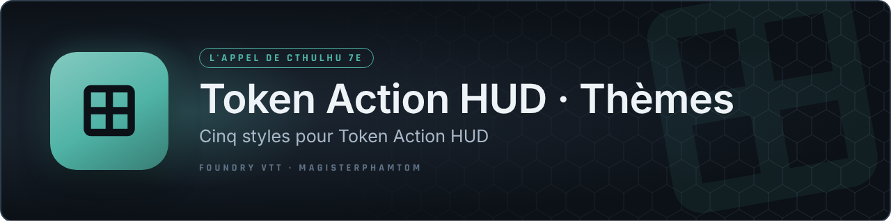
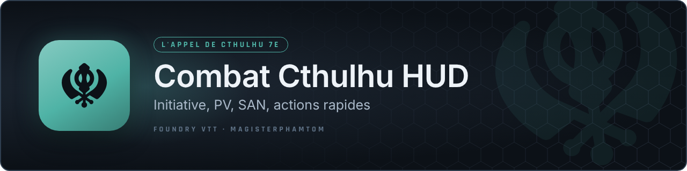
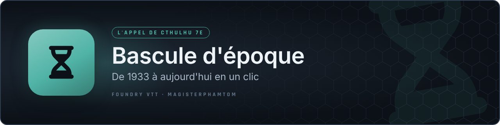
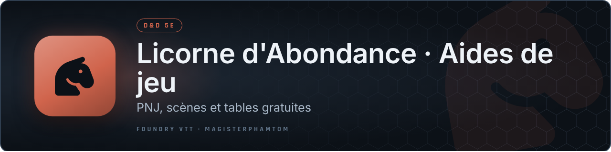
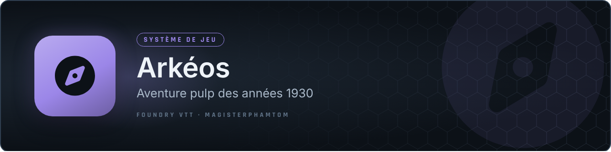

# Bonjour, je suis magisterphamtom 🎲

Meneur de jeu et streameur, je crée des **modules et des systèmes pour Foundry VTT** (v13 / v14), surtout pour L'Appel de Cthulhu et D&D 5e.

> 🤖 **Transparence :** les idées, la conception, les choix et les tests sont les miens ; le code est écrit avec l'assistance de l'IA **Claude** (Anthropic).

**Installer :** dans Foundry, *Modules complémentaires* (ou *Systèmes de jeu*) › *Installer* › coller le lien **manifeste** en bas de la fenêtre.

> *GM and streamer making Foundry VTT modules and game systems (mostly in French). Paste the manifest link into Foundry's install dialog.*

## 🐙 L'Appel de Cthulhu 7e (CoC7)

<table>
<tr>
<td width="50%" align="center"> Le chat et les jets aux couleurs de l'époque · <a href="https://github.com/magisterphamtom/coc7-cartes-chat/releases/latest/download/module.json">manifeste</a></td>
<td width="50%" align="center"> Années 20, New York, Montagnes Hallucinées, moderne · <a href="https://github.com/magisterphamtom/coc7-fiches-thematiques/releases/latest/download/module.json">manifeste</a></td>
</tr>
<tr>
<td width="50%" align="center"> Cinq styles pour Token Action HUD · <a href="https://github.com/magisterphamtom/tah-annees-20/releases/latest/download/module.json">manifeste</a></td>
<td width="50%" align="center"> Initiative, PV, SAN, actions rapides · <a href="https://github.com/magisterphamtom/combatcthud/releases/latest/download/module.json">manifeste</a></td>
</tr>
<tr>
<td width="50%" align="center"> Jets de groupe animés · <a href="https://github.com/magisterphamtom/roll-ensemble-coc7/releases/latest/download/module.json">manifeste</a></td>
<td width="50%" align="center"> La Chance du groupe en un coup d'œil · <a href="https://github.com/magisterphamtom/coc7-luck-tracker/releases/latest/download/module.json">manifeste</a></td>
</tr>
<tr>
<td width="50%" align="center"> La SAN de tous les investigateurs · <a href="https://github.com/magisterphamtom/coc7-san-tracker/releases/latest/download/module.json">manifeste</a></td>
<td width="50%" align="center"> Les liens qui retiennent les investigateurs · <a href="https://github.com/magisterphamtom/coc7-bonds-tracker/releases/latest/download/module.json">manifeste</a></td>
</tr>
<tr>
<td width="50%" align="center"> À pied ou en voiture, la jauge de poursuite · <a href="https://github.com/magisterphamtom/coc7-chase-tracker/releases/latest/download/module.json">manifeste</a></td>
<td width="50%" align="center"> De 1933 à aujourd'hui en un clic · <a href="https://github.com/magisterphamtom/coc7-bascule-epoque/releases/latest/download/module.json">manifeste</a></td>
</tr>
<tr>
<td width="50%" align="center"> Enveloppe scellée ou mail avec pièce jointe · <a href="https://github.com/magisterphamtom/distribution-aides-de-jeu/releases/latest/download/module.json">manifeste</a></td>
<td width="50%" align="center"> Qui parle, à toute la table · <a href="https://github.com/magisterphamtom/conversations-pnj/releases/latest/download/module.json">manifeste</a></td>
<td width="50%" align="center"> Le jet aux couleurs de l'époque · <a href="https://github.com/magisterphamtom/coc7-fenetre-jet/releases/latest/download/module.json">manifeste</a></td>
</tr>
</table>

## 🐉 Donjons & Dragons 5e

<table>
<tr>
<td width="50%" align="center"> Le 20 naturel mérite un spectacle · <a href="https://github.com/magisterphamtom/critiques-epiques/releases/latest/download/module.json">manifeste</a></td>
<td width="50%" align="center"> Un parchemin scellé qui se déroule · <a href="https://github.com/magisterphamtom/distribution-aides-fantasy/releases/latest/download/module.json">manifeste</a></td>
</tr>
<tr>
<td width="50%" align="center"> PNJ, scènes et tables gratuites · <a href="https://github.com/magisterphamtom/licorne-dabondance-free/releases/latest/download/module.json">manifeste</a></td>
<td width="50%"></td>
</tr>
</table>

## 🧰 Outils pour tous les systèmes

<table>
<tr>
<td width="50%" align="center"> Jusqu'à cinq barres flottantes · <a href="https://github.com/magisterphamtom/barres-macros-libres/releases/latest/download/module.json">manifeste</a></td>
<td width="50%" align="center"> Musique, bruitages et outils au bout des doigts · <a href="https://github.com/magisterphamtom/commandes-stream-deck/releases/latest/download/module.json">manifeste</a></td>
</tr>
<tr>
<td width="50%" align="center"> Qui parle au micro · <a href="https://github.com/magisterphamtom/speaking-status/releases/latest/download/module.json">manifeste</a></td>
<td width="50%" align="center"> Un onglet Journaux sans encombrement · <a href="https://github.com/magisterphamtom/dossiers-caches/releases/latest/download/module.json">manifeste</a></td>
</tr>
<tr>
<td width="50%" align="center"> Alt + molette, et c'est réglé · <a href="https://github.com/magisterphamtom/taille-jeton-molette/releases/latest/download/module.json">manifeste</a></td>
<td width="50%" align="center"> Vos tableaux Canva dans Foundry · <a href="https://github.com/magisterphamtom/lecteur-canva/releases/latest/download/module.json">manifeste</a></td>
</tr>
<tr>
<td width="50%" align="center"> Zoom, déplacement et vue partagée · <a href="https://github.com/magisterphamtom/handout-ping-viewer/releases/latest/download/module.json">manifeste</a></td>
<td width="50%" align="center"> Joueurs et Gardien se parlent en privé, en six habillages · <a href="https://github.com/magisterphamtom/messages-secrets/releases/latest/download/module.json">manifeste</a></td>
</tr>
<tr>
<td width="50%" align="center"> Plus aucune icône hors cadre sous le chat · <a href="https://github.com/magisterphamtom/chat-icones-visible/releases/latest/download/module.json">manifeste</a></td>
<td width="50%"></td>
</tr>
</table>

## 📜 Systèmes de jeu

<table>
<tr>
<td width="50%" align="center"> Aventure pulp des années 1930 · <a href="https://github.com/magisterphamtom/arkeos/releases/latest/download/system.json">manifeste</a></td>
<td width="50%" align="center"> Horreur lovecraftienne, système PLP · <a href="https://raw.githubusercontent.com/magisterphamtom/chants-de-tindalos/main/system.json">manifeste</a></td>
</tr>
<tr>
<td width="50%" align="center"> Médiéval-fantastique old-school en 2D6 · <a href="https://github.com/magisterphamtom/tranchons-et-traquons/releases/latest/download/system.json">manifeste</a></td>
<td width="50%" align="center"> Des héros face aux dieux · <a href="https://github.com/magisterphamtom/dieux-ennemis-nonofficiel/releases/latest/download/system.json">manifeste</a></td>
</tr>
<tr>
<td width="50%" align="center"> Dark fantasy, destin et Nexus (XII Singes) · en développement, pas encore de manifeste · <a href="https://github.com/magisterphamtom/ange-du-chaos">dépôt</a></td>
</tr>
</table>

---
Une question, un bug ? Ouvrez une *issue* sur le dépôt du module concerné.
